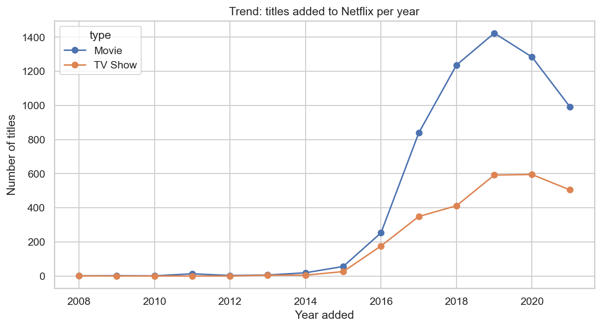
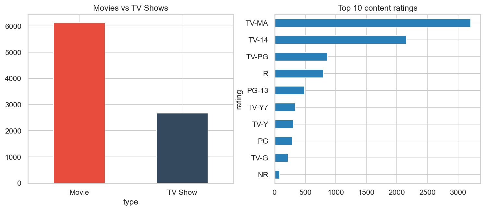
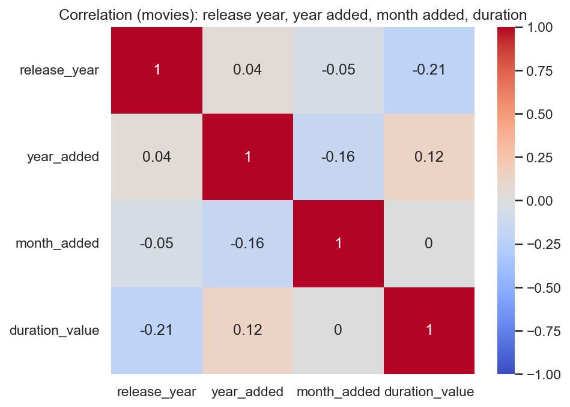
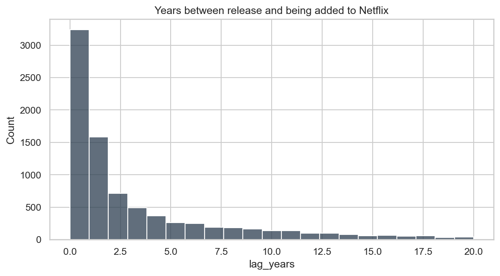

<p align="center"></p>

<p align="center"><a href="https://github.com/khnbutt118-dev">← Back to GitHub profile</a> · <a href="https://hassanbuttportfolio.vercel.app/">Portfolio</a> · <a href="https://www.linkedin.com/in/hassan-butt-ab0036334/">LinkedIn</a></p>

---

# Exploratory Data Analysis (Netflix)

> Synent Technologies Data Science Internship | Task 3 (Basic level) | Author: Hassan Butt

## Problem statement
Identify trends and patterns in the Netflix catalogue: what was added, when, from where and in which genres.

## Dataset details
- **Dataset:** Netflix Movies and TV Shows
- **Source:** https://www.kaggle.com/datasets/shivamb/netflix-shows
- **Size used:** 8,807 rows x 12 columns

## Approach
1. Parsed dates and durations, created year/month/lag features
2. Summary statistics and missing-value profile
3. Trend analysis of titles added per year by type
4. Top countries, genres and ratings
5. Correlation analysis between release year, year added, month added and movie duration

## Results
| Metric | Value |
|---|---|
| Titles analysed | 8807 |
| Peak year for additions | 2019 |
| Movie share | 70% |
| Top country | United States |
| Median movie duration (min) | 98 |

**Key insights**

- Netflix added the most titles in 2019 (2,016 titles) of all the years in the data.
- Movies make up 70% of the catalogue and TV shows 30%.
- The most common producing country is United States and the most common genre label is 'International Movies'.
- The median movie runs 98 minutes; correlation between release year and duration is -0.21.
- The median gap between a title's release and its addition to Netflix is 1 year(s); release year and year added correlate at r = 0.04 for movies.

**Figures**








**Other output files:** `summary_statistics.csv`, `correlation_movies.csv`, `missing_values_percent.csv`

## How to run
```bash
pip install -r requirements.txt
python main.py
```

## Project structure
```
main.py            # full analysis / pipeline
requirements.txt
data/              # dataset (see data/README.md)
outputs/           # figures, tables and reports
```

## Academic integrity
All analysis code and write-ups in this repository were written by the author. The dataset belongs to its original creators (see link above).
