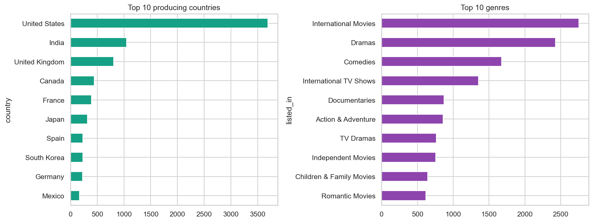
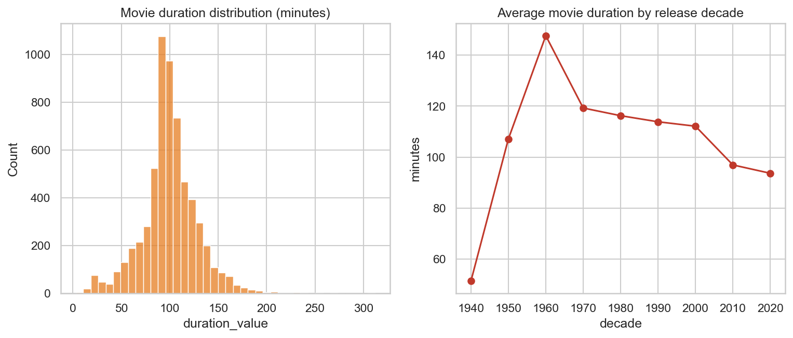

<p align="center"></p>
<p align="center"></p>
<p align="center"><a href="https://github.com/khnbutt118-dev">← Profile</a> · <a href="https://hassanbuttportfolio.vercel.app/">Portfolio</a> · <a href="https://www.linkedin.com/in/hassan-butt-ab0036334/">LinkedIn</a></p>

# 🎬 Netflix · Catalogue Exploratory Data Analysis
**Synent Technologies · Data Science Internship · Task 3**

<table><tr><td align="center"><h2>8,807</h2><sub>Titles analysed</sub></td><td align="center"><h2>2019</h2><sub>Peak additions year</sub></td><td align="center"><h2>70%</h2><sub>Movies in catalogue</sub></td><td align="center"><h2>98 min</h2><sub>Median movie duration</sub></td></tr></table>

## 📺 Visual story

<p align="center"></p>
<p align="center"></p>
<p align="center"></p>
<p align="center"></p>

## 🔎 What stood out

| Insight | Result |
|:--|:--|
| Titles in dataset | **8,807** |
| Peak year for additions | **2019 · 2,016 titles** |
| Catalogue split | **70% movies · 30% TV shows** |
| Most common producing country | **United States** |
| Most common genre label | **International Movies** |
| Median movie duration | **98 minutes** |

The median gap between a title's release and its addition to Netflix was one year. The relationship between release year and movie duration was weakly negative (r = -0.21).

## ▶️ Run

```bash
pip install -r requirements.txt
python main.py
```

<details><summary><b>Dataset & analysis</b></summary>

- Dataset: [Netflix Movies and TV Shows](https://www.kaggle.com/datasets/shivamb/netflix-shows)
- 8,807 rows × 12 columns
- Analysis covers additions over time, countries, genres, ratings, movie durations and release-to-added lag.
- Outputs: `outputs/`, `summary_statistics.csv`, `correlation_movies.csv`, `missing_values_percent.csv`
</details>

---
<p align="center"><sub>Exploratory data analysis · Visual analytics · Python</sub></p>